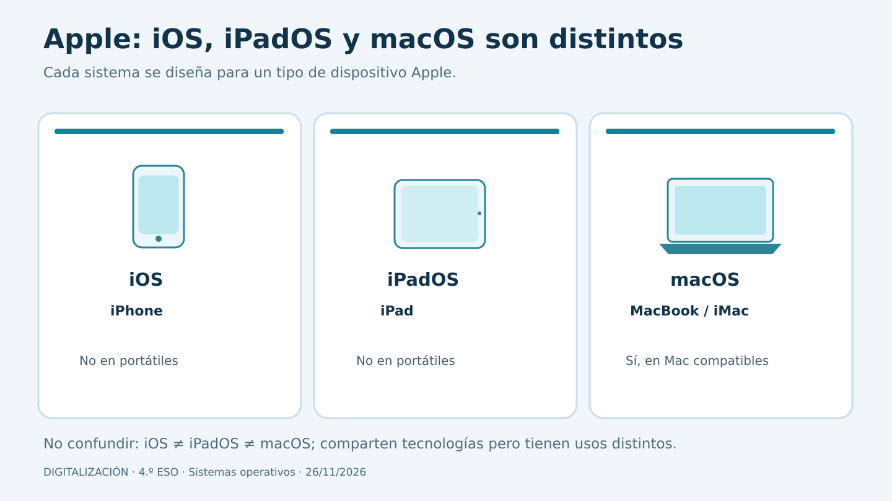
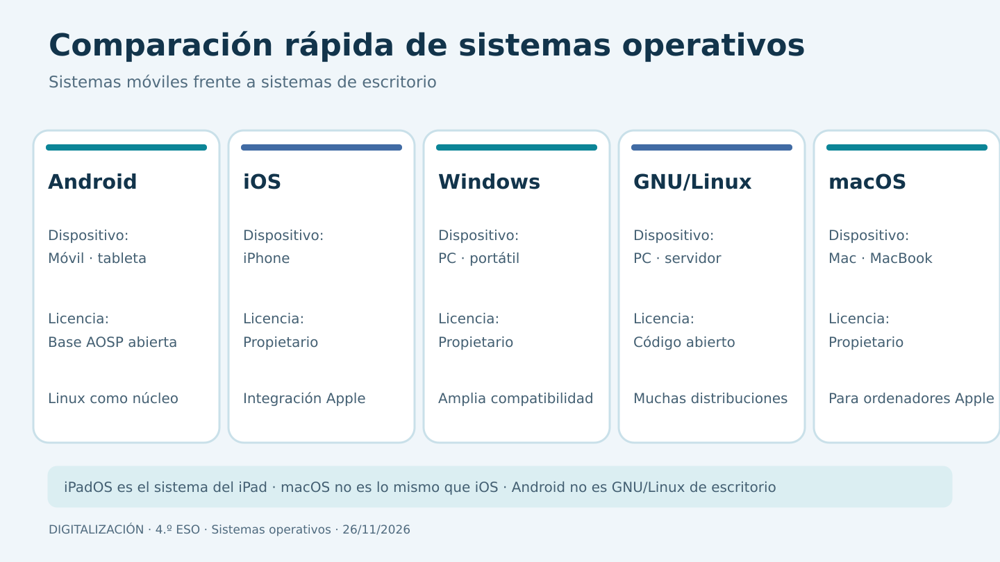
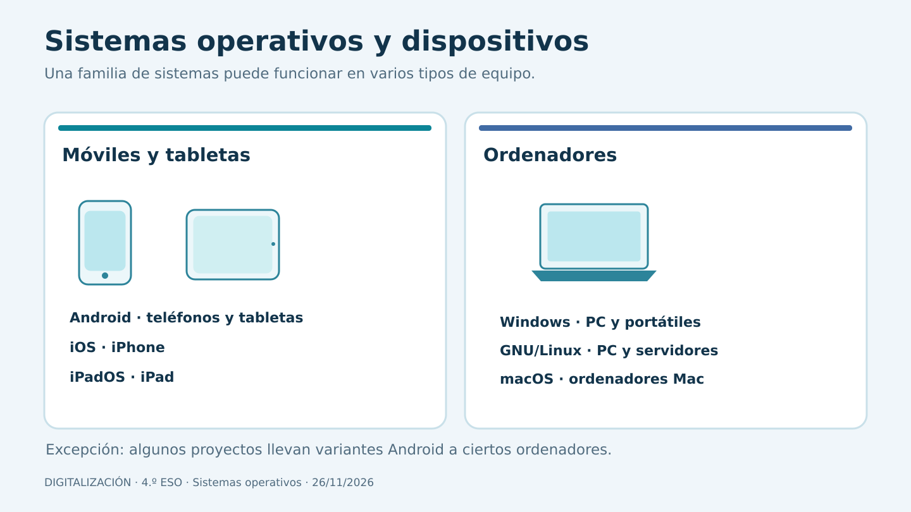

# Tema 2. Sistemas operativos

**Materia:** Digitalización · 4.º ESO · Comunitat Valenciana  
**Estado:** Contenido aprobado · material ampliable  
**Fecha:** 26/11/2026

[Volver al índice general](../../README.md)

## Materiales del tema

- [Presentación HTML — abrir en el navegador](https://htmlpreview.github.io/?https://github.com/bitschips/digitaliza4/blob/main/temas/tema-02-sistemas-operativos/presentaciones/tema-02.html)
- [Presentación PPTX — descargar](presentaciones/tema-02-sistemas-operativos.pptx)
- [Presentación NotebookLM]()

## Objetivos de aprendizaje

Al finalizar el tema podrás explicar para qué sirve un sistema operativo, identificar sus principales funciones, comparar Windows, macOS, GNU/Linux, Android e iOS, comprender las diferencias entre software libre y propietario, reconocer distribuciones Linux y practicar la preparación de un USB de arranque Live para diagnosticar y recuperar archivos de un equipo.

## 1. ¿Qué es un sistema operativo?

Un **sistema operativo (SO)** es el software básico que permite utilizar un ordenador, móvil o tableta y coordina el hardware con los programas y las personas. Al encender un equipo, el firmware inicia el proceso de arranque, que carga el sistema operativo; después podemos abrir aplicaciones, manejar archivos y utilizar dispositivos.

**Ejemplo:** cuando guardas un documento, el procesador ejecuta instrucciones, la RAM mantiene datos temporales y el sistema operativo organiza su almacenamiento en el SSD.

### Funciones principales

- **Gestionar procesos:** reparte tiempo de procesador entre los programas.
- **Gestionar memoria:** asigna RAM a las aplicaciones.
- **Gestionar archivos:** crea, organiza, busca y protege carpetas y documentos.
- **Controlar dispositivos:** se comunica con pantalla, teclado, impresora o Wi-Fi mediante controladores y otros componentes.
- **Facilitar la interacción:** proporciona un escritorio gráfico, aplicaciones y/o terminal.
- **Proteger el sistema:** controla usuarios, permisos, actualizaciones y acceso a recursos.

No hay que confundir **sistema operativo** con **aplicación**: Windows o Linux gestionan el equipo; un navegador o un procesador de textos realizan tareas concretas sobre el sistema.

<!-- IMAGEN: img/escritorio-sistema-operativo.svg | TITULO: El escritorio de un sistema operativo | POSICION: DESPUES -->

## 2. Breve historia y evolución

| Época | Evolución | Idea clave |
|---|---|---|
| Años 50–60 | Sistemas por lotes en grandes ordenadores | Ejecutaban trabajos sin interacción continua con el usuario. |
| Años 60–70 | Tiempo compartido; nacimiento de Unix | Varios usuarios y programas podían compartir un ordenador. |
| Años 80 | Ordenadores personales, MS-DOS y primeros entornos gráficos populares | Se extendió la informática doméstica. |
| Años 90 | Windows, GNU/Linux y evolución de Mac OS | Se consolidaron distintos modelos de sistema. |
| Años 2000 | macOS basado en Unix, popularización de Linux en servidores | Mayor importancia de Internet y las redes. |
| Años 2010–2020 | Android, iOS, nube, virtualización y contenedores | El sistema operativo está también en móviles y centros de datos. |

**Reflexión:** hoy podemos utilizar simultáneamente un sistema en el móvil, otro en el portátil y otro en el servidor que guarda nuestros archivos.

## 3. Tipos de sistemas operativos

- **De escritorio:** diseñados principalmente para ordenadores personales, como Windows, macOS y distribuciones de GNU/Linux.
- **Móviles:** optimizados para pantallas táctiles, batería y sensores, como Android e iOS.
- **De servidor:** orientados a ofrecer servicios en red con estabilidad, seguridad y administración remota.
- **Integrados o embebidos:** funcionan en routers, electrodomésticos, vehículos u otros dispositivos.
- **De tiempo real:** se diseñan para responder dentro de límites temporales definidos, importantes en determinados controles industriales.

Un mismo sistema o familia puede servir para varias categorías.

## 4. Principales sistemas operativos: comparación

| Sistema | Uso habitual | Licencia y coste básico | Aspecto importante |
|---|---|---|---|
| Windows | PC personales, empresas, videojuegos | Propietario; normalmente requiere licencia de pago, a menudo incluida en el precio del equipo | Amplia compatibilidad comercial |
| macOS | Ordenadores Apple | Propietario; incluido para equipos Apple compatibles | Integración con hardware Apple |
| GNU/Linux (Debian, Mint, etc.) | PC, servidores, educación | Muchas distribuciones son gratuitas y de código abierto; otras venden suscripciones o soporte | Se puede elegir entre distintas distribuciones |
| Android | Móviles, tabletas y otros equipos | Base de código abierto (AOSP), con componentes y servicios que pueden ser propietarios; normalmente incluido en el dispositivo | Gran variedad de fabricantes |
| iOS | iPhone | Propietario; incluido en iPhone compatible | Ecosistema de Apple |

**Importante:** «gratuito» describe el precio, mientras que **«software libre»** se refiere a libertades de uso, estudio, modificación y distribución según su licencia. Un software libre puede ofrecerse con servicios de pago; un programa gratuito puede ser propietario.

### 4.1. El coste real de un sistema operativo

Para comparar costes hay que distinguir **precio de la licencia**, **coste del equipo**, **mantenimiento**, **soporte profesional** y **formación**. Windows suele comercializarse con licencia, pero también puede venir preinstalado y pagado indirectamente dentro del precio del ordenador. Muchas distribuciones de Linux se pueden descargar, instalar y usar sin pagar licencia. **Red Hat Enterprise Linux**, en determinados usos, se ofrece mediante suscripciones comerciales que incluyen servicios y soporte.

**Ejemplo orientativo sin precios fijos:** instalar Linux Mint en un ordenador compatible puede no tener coste de licencia. Comprar un PC con Windows puede incluir el importe de su licencia. Una empresa puede decidir pagar una suscripción de Linux empresarial para recibir soporte especializado.

**Actividad breve:** ¿qué opción elegirías para diez ordenadores antiguos de un aula y por qué? Razona el coste total, no solo la descarga.

<!-- IMAGEN: img/comparacion-sistemas-operativos.svg | TITULO: Sistemas operativos en distintos dispositivos | POSICION: DESPUES -->

### 4.2. Sistemas operativos móviles: Android, iOS y su relación con el ordenador

Los sistemas operativos de **móviles y tabletas** realizan las mismas funciones básicas que Windows, macOS o GNU/Linux: administran la memoria, ejecutan aplicaciones, gestionan archivos y controlan los dispositivos. Suelen estar especialmente preparados para **pantallas táctiles, batería, cámaras, conectividad y sensores**.

#### 4.2.1. Android: un sistema basado en Linux

**Android** es un sistema operativo desarrollado principalmente por Google y utilizado por fabricantes como Samsung, Motorola o Xiaomi. Emplea el **núcleo Linux**, aunque su interfaz y muchas de sus aplicaciones son distintas de las de una distribución GNU/Linux de escritorio.

- **Dispositivos habituales:** teléfonos y tabletas de diferentes fabricantes; existen sistemas de la familia Android adaptados a televisores, relojes y coches.
- **Aplicaciones:** normalmente se instalan desde Google Play, pero según el dispositivo y la configuración también pueden utilizarse otras tiendas o archivos de instalación.
- **Personalización:** permite modificar numerosos aspectos de la interfaz, aunque los permisos dependen del fabricante.
- **Código abierto:** la base **AOSP (Android Open Source Project)** es abierta; Google Play y determinados servicios o componentes de los fabricantes son propietarios.

**¿Android en un portátil?** Existen proyectos como [Android-x86](https://www.android-x86.org/) y [Bliss OS](https://blissos.org/) para determinados ordenadores compatibles. Son alternativas especializadas, **no una instalación oficial de Android para cualquier portátil**, y pueden presentar problemas de controladores o soporte. Antes de probarlas, conviene comprobar sus versiones disponibles y su mantenimiento. **ChromeOS es otro sistema operativo**, aunque algunos Chromebooks pueden ejecutar aplicaciones Android.

#### 4.2.2. iOS: el sistema del iPhone

**iOS** es el sistema operativo de Apple para el **iPhone**. Está diseñado para trabajar con el hardware de este dispositivo y permite gestionar aplicaciones, llamadas, cámara, permisos, conexión a Internet y otras funciones.

- **Integración:** Apple diseña tanto el sistema como los dispositivos en los que se ejecuta.
- **Aplicaciones:** se distribuyen principalmente mediante la App Store; en algunos países, como los de la Unión Europea, existen otras opciones autorizadas por Apple bajo determinadas condiciones.
- **Seguridad y privacidad:** incorpora permisos para acceder a la cámara, la ubicación o el micrófono, así como mecanismos de protección y actualizaciones.
- **Personalización:** ofrece opciones de configuración, pero no permite instalarse libremente en un ordenador de otra marca.

**¿iOS en un portátil? No.** Un MacBook utiliza **macOS**, no iOS.

#### 4.2.3. iOS, iPadOS y macOS no son lo mismo

Apple desarrolla varios sistemas relacionados, pero **cada uno está destinado a una familia de dispositivos**:

| Sistema | Dispositivo habitual | ¿Puede instalarse normalmente en un portátil? |
|---|---|---|
| **iOS** | iPhone | No |
| **iPadOS** | iPad | No; se utiliza en tabletas iPad |
| **macOS** | MacBook, iMac, Mac mini y otros Mac compatibles | Sí, en portátiles Mac compatibles |

**Importante:** iPadOS se separó de iOS como sistema identificado específicamente para las tabletas iPad. Los tres comparten tecnologías de Apple, pero tienen interfaces y características adaptadas a sus dispositivos. **macOS no es una distribución de Linux**, aunque, como Linux, pertenece a la tradición de los sistemas de tipo Unix.



<!-- IMAGEN: img/tema-02-ios-vs-macos.svg | TITULO: iOS, iPadOS y macOS: cada dispositivo tiene su sistema | POSICION: DESPUES -->

#### 4.2.4. Android, iOS, Windows, GNU/Linux y macOS: comparación

| Característica | Android | iOS | Windows | GNU/Linux | macOS |
|---|---|---|---|---|---|
| Uso principal | Móviles y tabletas | iPhone | PC y portátiles | PC, portátiles y servidores | Ordenadores Mac |
| Fabricante o comunidad | Google y fabricantes | Apple | Microsoft | Comunidad y empresas | Apple |
| ¿Código abierto? | Base AOSP, sí; otros componentes pueden ser cerrados | Propietario | Propietario | Generalmente libre y abierto | Propietario |
| Instalación en portátiles | Solo variantes o proyectos compatibles | No | Sí, si el equipo es compatible | Sí, si el equipo es compatible | Sí, en Mac compatibles |
| Interacción más común | Táctil | Táctil | Teclado, ratón y también táctil | Teclado, ratón y también táctil | Teclado, ratón y trackpad |

**No confundas «fácil de personalizar» con «siempre seguro»**: todos necesitan actualizaciones y buenas prácticas. Tampoco todos los portátiles permiten instalar cualquier sistema; influyen el procesador, los controladores, la licencia y la compatibilidad.



<!-- IMAGEN: img/tema-02-comparativa-so.svg | TITULO: Comparación de Android, iOS, Windows, GNU/Linux y macOS | POSICION: DESPUES -->

#### 4.2.5. ¿Dónde podemos instalar cada sistema?

- **Android:** principalmente móviles y tabletas; variantes de la familia Android en televisores, relojes y otros equipos. En determinados ordenadores, mediante proyectos específicos.
- **iOS:** iPhone compatibles. **iPadOS:** tabletas iPad compatibles.
- **Windows:** ordenadores de sobremesa, portátiles y otros equipos compatibles.
- **GNU/Linux:** ordenadores, portátiles, servidores, Raspberry Pi y algunos sistemas especializados; la compatibilidad depende de la distribución.
- **macOS:** ordenadores Mac compatibles, incluidos **MacBook** (portátiles), iMac y Mac mini.



<!-- IMAGEN: img/tema-02-so-tipos.svg | TITULO: Relación entre sistemas operativos y dispositivos | POSICION: DESPUES -->

**Comprueba que lo has entendido:** ¿qué sistema elegirías para un portátil antiguo? ¿Podrías instalar iOS en él? ¿Por qué un MacBook funciona con macOS y un iPhone con iOS?

**Fuentes para ampliar:** [Android Open Source Project](https://source.android.com/docs/setup/about), [sistemas operativos de Apple](https://www.apple.com/es/os/), [instalación de Android-x86](https://www.android-x86.org/installhowto.html) y [estado actual de Bliss OS](https://blissos.org/status.html).

## 5. Cómo funciona un sistema operativo

El **núcleo o kernel** es una parte central del sistema: coordina operaciones de bajo nivel y recursos como procesos, memoria y dispositivos. Los programas utilizan servicios del sistema para realizar tareas que no deberían ejecutar directamente sobre el hardware.

- **Proceso:** programa en ejecución; por ejemplo, dos navegadores o un editor.
- **Multitarea:** el sistema intercala o ejecuta trabajo de varias aplicaciones.
- **Memoria RAM:** mantiene los datos de trabajo; el sistema asigna y protege espacios de memoria.
- **Controladores (drivers):** permiten que el sistema interactúe con determinados dispositivos.
- **Usuarios y permisos:** limitan qué archivos y operaciones puede utilizar cada cuenta.

**Ejemplo:** si abres varias pestañas y el equipo se ralentiza, pueden estar compitiendo por RAM, CPU o almacenamiento. No significa automáticamente que haya un virus.

## 6. Interfaz gráfica y terminal

La **interfaz gráfica (GUI)** utiliza ventanas, iconos, menús y puntero. La **línea de comandos (CLI)** permite escribir instrucciones en una terminal. Ambas son formas de interactuar con el sistema, no sistemas operativos distintos.

Ejemplos básicos para Linux (en una carpeta de prueba):

```bash
pwd          # muestra el directorio actual
ls           # lista archivos y carpetas
mkdir prueba # crea una carpeta
cd prueba    # entra en ella
```

El alumnado debe realizar estos comandos en una cuenta de prácticas y comprender qué hacen antes de ejecutarlos. No introducir comandos destructivos ni usar privilegios de administrador sin supervisión.

## 7. Archivos, carpetas, rutas y permisos

Un **archivo** almacena información; una **carpeta o directorio** permite organizar archivos. La **ruta** indica su ubicación. Una **extensión**, como `.txt`, `.jpg` o `.py`, suele ayudar a reconocer el formato, aunque no garantiza por sí sola el tipo real de archivo.

- Ruta típica en Windows: `C:\\Usuarios\\Alumno\\Documentos`.
- Ruta típica en Linux: `/home/alumno/Documentos`.
- La cuenta de usuario y los permisos determinan quién puede leer, modificar o ejecutar determinados archivos.
- Los sistemas de archivos, como NTFS, ext4 o FAT32, organizan cómo se almacenan los datos en los dispositivos.

**Actividad:** crear una estructura con carpetas `Digitalizacion/Tema2/Practicas`, guardar un archivo de texto y localizar su ruta.

## 8. Distribuciones GNU/Linux y descarga de sistemas operativos

**Linux** es el nombre de un núcleo (*kernel*). Una **distribución GNU/Linux** reúne el núcleo con programas, herramientas de instalación, actualizaciones y, en muchos casos, un escritorio. Algunas distribuciones están orientadas al uso cotidiano; otras, a servidores o equipos con pocos recursos.

### 8.1. Comparación y enlaces oficiales de descarga

Esta tabla reúne en un solo lugar las distribuciones estudiadas y los **enlaces a sus páginas oficiales de descarga**. También incluye Windows 11 para comparar un sistema propietario con las alternativas GNU/Linux. Las páginas pueden ofrecer distintas ediciones, arquitecturas e imágenes ISO.

| Sistema | Uso recomendado y características | Coste, requisitos y observaciones | Descarga oficial |
|---|---|---|---|
| **Linux Mint** | Escritorio sencillo para iniciarse en Linux; Cinnamon, MATE o Xfce. | Descarga gratuita. Xfce suele consumir menos recursos que Cinnamon; comprobar requisitos. | [Linux Mint — Descargas](https://www.linuxmint.com/download.php) |
| **Debian GNU/Linux** | PC, servidores y educación; configurable con distintos escritorios. | Descarga gratuita. Ofrece imágenes de instalación (*netinst*) y opciones Live; requisitos según edición. | [Debian — Descargar e instalar](https://www.debian.org/distrib/) |
| **Alpine Linux** | Distribución minimalista para servidores, contenedores y proyectos técnicos. | Gratuita y muy ligera en configuraciones mínimas, pero no es un escritorio listo para principiantes. | [Alpine Linux — Downloads](https://alpinelinux.org/downloads/) |
| **Ubuntu Desktop** | Ordenadores personales y portátiles; versiones LTS con soporte prolongado. | Descarga gratuita; comprobar los requisitos de la edición y la arquitectura. | [Ubuntu — Download Desktop](https://ubuntu.com/download/desktop) |
| **Fedora Workstation** | Escritorio moderno con tecnologías actuales; permite probar el sistema en modo Live. | Descarga gratuita; comprobar requisitos del equipo. | [Fedora — Descargar Workstation](https://fedoraproject.org/workstation/download/) |
| **LliureX** | Distribución educativa de la Comunitat Valenciana, adaptada a centros y aulas. | Descarga gratuita; consultar los requisitos y las versiones disponibles. | [LliureX — Portal oficial](https://portal.edu.gva.es/lliurex/) |
| **Red Hat Enterprise Linux (RHEL)** | Servidores y empresas con necesidades de administración y soporte. | Distribución comercial con suscripciones; existen modalidades de acceso gratuito para usos específicos. | [Red Hat — Información y descarga](https://www.redhat.com/en/technologies/linux-platforms/enterprise-linux) |
| **Windows 11** | PC, portátiles, aplicaciones comerciales y videojuegos. | La ISO se puede descargar desde Microsoft; para utilizarlo y activarlo se necesita una licencia válida y hardware compatible. | [Microsoft — Descargar Windows 11 (ISO)](https://www.microsoft.com/es-es/software-download/windows11) |

**¿Cuál elegir según el equipo?**

- **Primer contacto con Linux:** Linux Mint o Ubuntu; en centros valencianos, también LliureX si el equipo es compatible.
- **Ordenador antiguo:** Mint Xfce o Debian con un escritorio ligero, comprobando siempre la RAM y los controladores.
- **Servidor o proyecto técnico:** Debian o Alpine; RHEL si se requiere soporte empresarial.
- **PC con Windows:** Windows 11 solo si cumple sus requisitos; su ISO se descarga desde la web de Microsoft.

**No confundir:** poder descargar gratis una ISO no significa que todas las licencias o servicios sean gratuitos. Tampoco una distribución ligera garantiza que funcione en cualquier ordenador.

<!-- IMAGEN: img/distribuciones-linux.svg | TITULO: Distribuciones GNU/Linux | POSICION: DESPUES -->

### 8.2. ¿Qué es una ISO y cómo se utiliza?

Una **imagen ISO** es un archivo que contiene una imagen de un soporte de instalación o arranque. Para conseguir una, entra en uno de los **enlaces oficiales de la tabla**, elige una edición y una arquitectura compatibles con tu equipo (por ejemplo, **x86-64/amd64**) y lee sus requisitos.

1. **Descarga la ISO**, sin confundir la descarga con la instalación.
2. **Comprueba su integridad**, cuando el proyecto publique una suma de comprobación SHA-256 y sus instrucciones de verificación.
3. **Prueba el sistema** en una máquina virtual o crea un USB arrancable si la imagen permite hacerlo; copiar el fichero `.iso` como un documento normal no suele crear un USB de arranque.
4. Si el sistema ofrece un **modo Live**, puedes explorarlo antes de instalarlo. No todas las imágenes o distribuciones ofrecen el mismo modo de prueba.
5. **Antes de instalar**, realiza una copia de seguridad y pide autorización: el instalador podría modificar particiones y borrar archivos.

**Ejemplo:** en la página de Windows 11 hay que localizar la opción para descargar una imagen de disco (ISO). En Debian, Mint, Ubuntu y Fedora se debe elegir la imagen adecuada para el equipo y, si interesa practicar sin instalar, una versión que permita probar el sistema.

**Actividad breve de investigación:** elige dos sistemas de la tabla, localiza la descarga para un ordenador de 64 bits, comprueba si ofrecen modo Live y explica cuál sería más adecuado para un ordenador del aula. **No es necesario descargar ni instalar nada para completar esta investigación.**

## 9. Crear un USB de arranque desde Linux y utilizarlo en modo Live

**Objetivo:** arrancar temporalmente un ordenador con Linux desde una memoria USB, sin instalarlo, para conocer el sistema o intentar acceder a archivos de un ordenador cuyo sistema habitual no arranca.

**Material:** ordenador Linux operativo, una memoria USB de capacidad suficiente y una imagen ISO de una distribución que ofrezca modo Live. **Atención: preparar el USB suele borrar todo su contenido.**

1. Descargar la ISO desde la página oficial de Linux Mint u otra distribución con modo Live.
2. Conectar una memoria USB vacía o con archivos ya respaldados.
3. Abrir una herramienta gráfica adecuada en Linux, por ejemplo **Discos de GNOME** (opción de restaurar imagen de disco, cuando esté disponible) o **KDE ISO Image Writer**. Seleccionar la ISO y comprobar cuidadosamente el USB de destino.
4. Grabar la imagen. No copiar simplemente el archivo `.iso` al USB como si fuera un documento: hay que crear el medio arrancable con una herramienta apropiada.
5. Reiniciar el ordenador de prueba y abrir su **menú de arranque** (la tecla varía según fabricante; puede ser F12, Esc, F9 u otra).
6. Seleccionar el USB y elegir **Probar / Live** si el menú lo permite. No elegir instalar si solo se quiere probar.
7. Explorar el escritorio, el administrador de archivos y, si procede, una unidad interna accesible. Copiar los documentos recuperables a un almacenamiento externo distinto.

**Limitaciones y precauciones:** algunos equipos necesitan ajustes compatibles de UEFI/Secure Boot; un disco cifrado requerirá la clave; un soporte físicamente dañado puede ser ilegible; un USB Live no garantiza recuperar todos los ordenadores ni reparar cualquier avería. En equipos del aula, hacerlo siempre con permiso y supervisión. Evitar modificar particiones o escribir sobre un disco que pueda estar dañado antes de salvaguardar sus datos.

<!-- IMAGEN: img/usb-live-linux.svg | TITULO: Arranque desde un USB Live | POSICION: DESPUES -->

**Actividad de clase:** en un ordenador autorizado, preparar un USB Live, arrancar una sesión de prueba, identificar el sistema operativo y localizar una carpeta de ejemplo. Documentar en cuatro capturas los pasos y explicar por qué el sistema instalado permanece sin cambios cuando no se ejecuta el instalador ni se modifica el disco.

<!-- IMAGEN: img/recuperacion-archivos-linux.svg | TITULO: Recuperación de archivos de Windows con Linux Live | POSICION: DESPUES -->

## 10. Actualizaciones, mantenimiento y seguridad

Actualizar el sistema y sus aplicaciones corrige errores y vulnerabilidades. Conviene usar fuentes oficiales, realizar copias de seguridad, proteger las contraseñas, limitar los permisos de administrador y reconocer mensajes sospechosos. Un equipo sin actualizaciones de seguridad es más vulnerable, independientemente de que utilice Windows, Linux o macOS.

## 11. Actividades propuestas

**[Abrir el índice de actividades del tema](actividades/README.md)**. Las actividades desarrolladas están en archivos independientes y se incorporarán nuevas actividades a este índice.

1. **Identificar funciones:** relacionar seis acciones (imprimir, guardar, abrir aplicación, conectar Wi-Fi, cambiar usuario, ejecutar dos programas) con funciones del sistema operativo.
2. **Comparar costes:** elaborar una tabla de tres casos (PC con Windows, PC con Mint, servidor con RHEL) diferenciando licencia, soporte, hardware y mantenimiento.
3. **Investigar distribuciones:** elegir dos de Mint, Alpine, Debian, RHEL o LliureX y comparar público objetivo, requisitos, escritorio y licencia.
4. **Archivos y terminal:** crear, localizar y mostrar el contenido de una carpeta de pruebas desde la interfaz gráfica y el terminal.
5. **USB Live:** preparar un USB con una ISO oficial y practicar el arranque en un equipo autorizado, sin instalar ni modificar sus discos.

## 12. Preguntas de repaso

1. ¿Por qué el sistema operativo no es lo mismo que una aplicación?
2. ¿Qué función tienen el kernel, la RAM y los controladores?
3. ¿Qué diferencia existe entre interfaz gráfica y terminal?
4. ¿En qué se diferencian «gratuito», «libre» y «propietario»?
5. ¿Por qué una distribución Linux puede ser gratis y otra tener soporte de pago?
6. ¿Qué distribución elegirías para un ordenador antiguo y por qué?
7. ¿Qué es una ISO y por qué no basta normalmente con copiarla como archivo a una memoria USB?
8. ¿Qué permite hacer un sistema Live y qué limitaciones tiene?
9. ¿Por qué es importante realizar una copia de seguridad antes de instalar un sistema operativo?
10. ¿En qué se diferencian iOS, iPadOS y macOS?
11. ¿Se puede instalar Android en cualquier portátil? ¿Por qué?

## 13. Glosario

- **Sistema operativo:** software base que coordina recursos y permite ejecutar aplicaciones.
- **Kernel o núcleo:** componente central del sistema operativo.
- **Proceso:** programa en ejecución.
- **Controlador:** componente de software que facilita la comunicación con un dispositivo.
- **GUI / CLI:** interfaz gráfica / interfaz de línea de comandos.
- **Distribución:** conjunto de sistema, herramientas y aplicaciones preparado para su instalación o uso.
- **Software libre:** software que respeta ciertas libertades de uso, estudio, modificación y redistribución.
- **Software propietario:** software cuyo uso, modificación o distribución están restringidos por su licencia.
- **ISO:** archivo con una imagen de medio de instalación o arranque.
- **USB Live:** memoria arrancable que permite iniciar un sistema sin instalarlo en el disco interno.
- **UEFI:** firmware moderno que ayuda a iniciar el ordenador.
- **AOSP:** proyecto de código abierto que proporciona la base de Android.
- **iPadOS:** sistema operativo de Apple para sus tabletas iPad.
- **macOS:** sistema operativo de los ordenadores Mac; distinto de iOS.
- **Partición:** división lógica de un dispositivo de almacenamiento.


<!-- PRESENTACION:EXCLUIR -->

## 14. Ampliación opcional: casos reales de uso y mantenimiento cotidiano

Este apartado complementa el temario básico y **no se incorpora automáticamente a las presentaciones**. Conecta el funcionamiento de los sistemas operativos con situaciones que pueden surgir en casa o en el aula.

### 14.1. ¿Qué ocurre al encender un ordenador?

1. Al pulsar el botón de encendido, el equipo comienza a alimentar sus componentes.
2. El firmware **UEFI/BIOS** comprueba e inicializa parte del hardware y localiza un dispositivo de arranque.
3. Un **gestor de arranque** inicia la carga del sistema operativo.
4. El **núcleo o kernel** comienza a gestionar memoria, procesos y dispositivos.
5. Se inician servicios y aparece la pantalla de inicio de sesión y, después, el escritorio.

**Relación con el Tema 1:** la CPU ejecuta instrucciones, el almacenamiento contiene el sistema y la RAM permite cargar los programas en funcionamiento.

### 14.2. Máquinas virtuales: dos sistemas operativos en un equipo

Una **máquina virtual** es un ordenador simulado mediante software. Herramientas como VirtualBox permiten, en equipos compatibles y con recursos suficientes, probar un sistema operativo invitado (por ejemplo, Debian) dentro de otro anfitrión (por ejemplo, Windows o Linux), sin reemplazar el sistema original.

**Ejemplo:** arrancar Debian en una ventana, practicar con carpetas y apagar la máquina virtual. Necesita RAM, CPU y almacenamiento propios asignados y un archivo ISO o disco virtual. No confundir una máquina virtual con arrancar un USB Live.

### 14.3. Dar una segunda vida a un ordenador antiguo

En un equipo con poca RAM o procesador modesto puede ser útil una distribución con entorno de escritorio ligero, como Debian con LXQt/Xfce o Linux Mint Xfce. **No todos los sistemas Linux consumen menos que Windows**: el resultado depende de la versión, el escritorio, los servicios, los controladores y las aplicaciones abiertas.

**Actividad propuesta:** anotar procesador, RAM y almacenamiento de un ordenador y comparar los requisitos oficiales de varias distribuciones. Hablar también del ahorro económico y de la reducción de residuos electrónicos por reutilización.

### 14.4. ¿Qué hacer cuando una aplicación se bloquea?

El sistema operativo gestiona procesos y puede ayudar a identificar un programa que no responde. En Windows puede utilizarse el **Administrador de tareas**; en Linux, el **Monitor del sistema** o herramientas equivalentes. Antes de finalizar una aplicación es conveniente intentar guardar el trabajo; cerrar a la fuerza puede hacer perder cambios sin guardar.

**Práctica:** abrir dos aplicaciones, consultar su consumo aproximado de CPU y memoria, y describir las diferencias sin forzar bloqueos reales.

### 14.5. Privacidad y permisos

Los sistemas operativos ofrecen configuraciones relacionadas con ubicación, cámara, micrófono, actualizaciones y datos de diagnóstico. Algunas funciones y servicios pueden recopilar información según las opciones activadas y las políticas del proveedor.

**Práctica:** revisar los permisos de una aplicación de ejemplo sin modificar cuentas ajenas ni compartir información personal.

### 14.6. Recuperar archivos cuando Windows no arranca

A veces **Windows deja de arrancar, pero los archivos siguen guardados en el disco**. Un USB con una distribución Linux en modo Live puede permitir acceder a ellos y copiarlos a otra unidad, siempre que el almacenamiento sea legible y se disponga de las credenciales o claves necesarias. **Rescatar archivos no equivale a reparar Windows.**

**Actividad práctica de ampliación:** [Recuperar archivos de un Windows que no arranca mediante un USB Live de Linux](actividades/actividad-01-recuperar-archivos-windows-usb-linux.md). Se realiza sobre equipos autorizados con archivos ficticios, sin reinstalar ni modificar particiones. Un disco cifrado o averiado puede requerir asistencia especializada.

<!-- PRESENTACION:FIN_EXCLUSION -->

---

## Control de versiones

- **Versión del contenido:** 1.5.0
- **Última actualización:** 26/11/2026
- **Estado:** Contenido aprobado y ampliable
