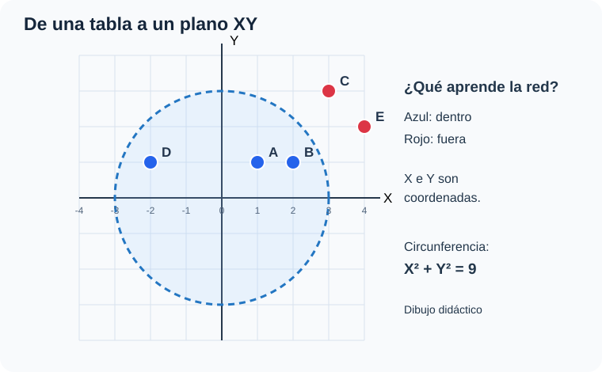
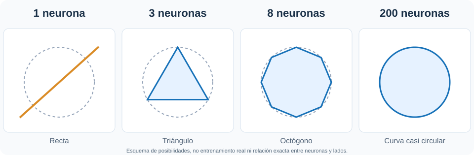
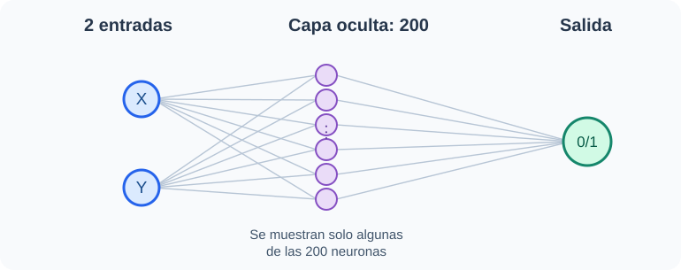
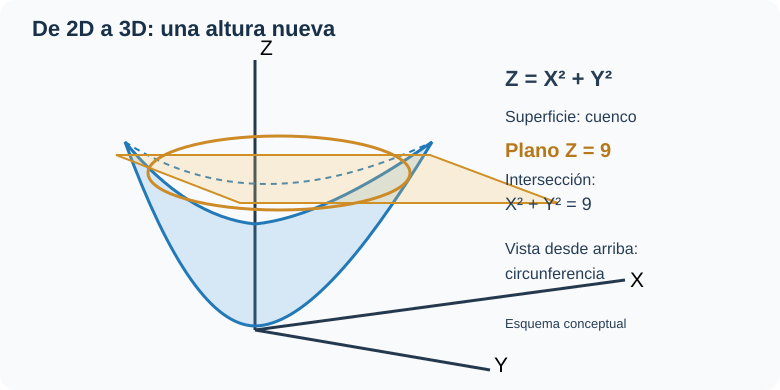

# Actividad 4. ¿Cuántas neuronas hacen falta para dibujar un círculo?

**Materia:** Digitalización · 4.º ESO · Tema 8: Programación e inteligencia artificial  
**Duración orientativa:** 55–65 minutos · **Modalidad:** individual o parejas  
**Material:** cuaderno, calculadora y los esquemas de esta actividad. No es necesario programar.

[Volver al tema 8](../tema-08.md) · [Volver al índice de actividades](README.md)

## Objetivos

- Relacionar una tabla de datos con puntos del plano XY.
- Comprender la suma ponderada de una neurona: entradas, pesos y sesgo.
- Distinguir una **recta en 2D**, un **plano en 3D** y una **superficie curva**.
- Comparar redes con 1, 3, 8 y 200 neuronas, sin confundir dibujos esquemáticos con un entrenamiento real.
- Descubrir por qué transformar las entradas puede simplificar una clasificación.

## 1. Recordamos la actividad de ir a la playa

En el ejemplo de ir a la playa, las entradas podían ser binarias (1 = sí; 0 = no):

| Buen tiempo (x₁) | Poco viento (x₂) | Buenas olas (x₃) | ¿Ir? (salida deseada) |
|---:|---:|---:|---:|
| 1 | 1 | 1 | 1 |
| 1 | 0 | 1 | 0 |
| 0 | 1 | 0 | 0 |
| 1 | 1 | 0 | 1 |

Una neurona calcula **z = x₁·w₁ + x₂·w₂ + x₃·w₃ + b**. Cada **w** es un peso y **b** es el sesgo. La salida final depende de una función de activación.

**Pregunta 1.** ¿Cuántas entradas tiene esta neurona? ¿Por qué cada columna solo utiliza 0 o 1? ¿Es necesario que todas las neuronas reciban entradas binarias?

## 2. Ahora las entradas son coordenadas X e Y

Cada fila representa un punto. **X e Y son números**, y pueden ser positivos, negativos o decimales. La salida deseada indica si está dentro (0, azul) o fuera (1, rojo) de un círculo de radio 3 centrado en (0, 0).

| Punto | X | Y | Clase deseada |
|---|---:|---:|---|
| A | 1 | 1 | Dentro / azul (0) |
| B | 2 | 1 | Dentro / azul (0) |
| C | 3 | 3 | Fuera / rojo (1) |
| D | -2 | 1 | Dentro / azul (0) |
| E | 4 | 2 | Fuera / rojo (1) |

**Pregunta 2.** Localiza A, C y D en el dibujo. ¿Por qué un valor negativo de X no impide representar un punto?

## 3. Una neurona con solo X e Y

La operación de la neurona es **z = X·w₁ + Y·w₂ + b**. Por ejemplo, si **w₁ = 1**, **w₂ = 1** y **b = -3**, la frontera viene dada por **X + Y - 3 = 0**, que es una **recta** en el plano XY. El signo de z permite separar los dos semiplanos.

Una recta puede separar correctamente ciertos puntos, pero **no puede delimitar exactamente todo el interior de un círculo**. Cambiar pesos y sesgo mueve o gira la recta.

**Pregunta 3.** Calcula z para A = (1, 1) y C = (3, 3). ¿Qué ocurre si el sesgo pasa de -3 a -5?

## 4. ¿Qué pasa con 3, 8 o 200 neuronas?

Este gráfico compara **posibles formas de frontera**, no resultados reales del entrenamiento.

- **1 neurona de salida con entradas X e Y y umbral:** una recta.
- **3 neuronas ocultas, convenientemente combinadas con una salida:** pueden construir un límite triangular.
- **8 neuronas ocultas, combinadas adecuadamente:** pueden construir un borde poligonal más próximo a un círculo.
- **200 neuronas ocultas:** una red con activaciones no lineales y pesos bien entrenados tiene capacidad para aproximar una circunferencia con bastante precisión. No dibuja automáticamente 200 segmentos ni garantiza aprender mejor.

**Importante:** cada neurona no corresponde obligatoriamente a una línea dibujada. La forma final depende de las capas, activaciones, pesos, sesgos y datos de entrenamiento. Un círculo en el plano es una **curva cerrada** que delimita una región, no una superficie tridimensional. No estamos dibujando «infinitas líneas»: aproximamos una curva mediante segmentos o funciones.

### ¿Cómo se organiza una red con 200 neuronas?

La red conserva **dos entradas originales (X e Y)**. Las 200 neuronas ocultas procesan combinaciones de esas entradas; una neurona de salida combina sus resultados para decidir entre dentro y fuera. También podríamos añadir **varias capas ocultas**, obteniendo funciones de mayor complejidad. Más neuronas o capas no garantizan mejores resultados: hay que entrenar, evaluar y evitar el sobreajuste.

**Pregunta 4.** ¿Por qué un octógono puede parecerse más a una circunferencia que un triángulo? ¿Tendría sentido usar 200 neuronas para cualquier problema?

## 5. Otra estrategia: transformar las entradas en X² e Y²

Podemos crear columnas nuevas a partir de los mismos dos datos originales:

| Punto | X | Y | X² | Y² | z = X² + Y² - 9 | Clasificación |
|---|---:|---:|---:|---:|---:|---|
| A | 1 | 1 | 1 | 1 | -7 | Dentro |
| B | 2 | 1 | 4 | 1 | -4 | Dentro |
| C | 3 | 3 | 9 | 9 | 9 | Fuera |
| D | -2 | 1 | 4 | 1 | -4 | Dentro |
| E | 4 | 2 | 16 | 4 | 11 | Fuera |

**Atención a las entradas:** si introducimos solamente X² e Y², la neurona tiene **dos entradas transformadas**, con fórmula **z = w₁·X² + w₂·Y² + b**. Si le damos simultáneamente X, Y, X² e Y², tendría **cuatro entradas**. En los dos casos seguimos partiendo de **dos variables originales**.

Para **w₁ = 1**, **w₂ = 1** y **b = -9** obtenemos **z = X² + Y² - 9**. Clasificamos **dentro cuando z < 0**, **sobre la frontera cuando z = 0** y **fuera cuando z > 0**. La frontera **X² + Y² = 9** es una **circunferencia de radio 3**.

No hemos creado información de la nada: calculamos características nuevas que facilitan la separación.

**Actividad guiada:** tapa la columna z y calcula A, B, C y D. Explica por qué D tiene X = -2 pero X² = 4. Calcula también el punto F = (3, 0) y di si está dentro, fuera o sobre la frontera.

## 6. ¡Y ahora el salto de 2D a 3D!

- **En 2D** dibujamos cada punto en (X, Y). Una neurona lineal con dos entradas determina una **recta** de separación.
- **En 3D** un punto tiene tres coordenadas (X, Y, Z). Una frontera lineal en tres variables es un **plano**.
- Si definimos una coordenada nueva **Z = X² + Y²**, levantamos cada punto del plano XY hasta una **altura Z**. Los puntos forman un **paraboloide**, con aspecto de cuenco.
- Cortamos ese cuenco mediante el **plano horizontal Z = 9**. Su intersección cumple **X² + Y² = 9**. Al verla desde arriba, aparece una circunferencia en el plano XY.

**Ojo:** escribir X² e Y² no crea por sí solo una tercera dimensión. En esta visualización 3D hemos **definido expresamente Z**. También es posible usar X² e Y² como dos entradas transformadas sin dibujar nada en 3D.

**Pregunta 5.** Completa: en dos dimensiones una frontera lineal es una ______; en tres dimensiones es un ______. ¿Cómo se llama la superficie Z = X² + Y²? ¿Qué representa el corte con Z = 9?

## 7. Reto final: ¿200 neuronas o mejores entradas?

Compara estas dos soluciones para el **mismo problema de separar puntos dentro/fuera de un círculo**:

| Estrategia | Datos de partida | Qué hace la red | Frontera |
|---|---|---|---|
| Red con capa oculta de muchas neuronas | X e Y | Aprende combinaciones no lineales | Aproximación flexible del círculo |
| Una neurona con entradas transformadas | X² e Y², calculadas desde X e Y | Suma ponderada sencilla y umbral | Circunferencia exacta para los pesos indicados |

**Responde razonadamente:**

1. ¿Cuál utiliza menos neuronas para resolver este círculo concreto?
2. ¿Cuál requiere que una persona haya elegido de antemano la transformación matemática X² e Y²?
3. Si la frontera fuese irregular y desconocida, ¿podría resultar ventajosa una red con más neuronas?
4. ¿Por qué «200 neuronas» no significa «200 rectas garantizadas»?
5. Explica con tus palabras qué diferencia hay entre **línea**, **plano** y **superficie curva**.

### Conclusión que debes recordar

**No siempre gana la red más grande.** Una buena representación de las entradas puede transformar un problema difícil en otro más sencillo. En 2D podemos aproximar un círculo mediante fronteras poligonales; en un espacio transformado podemos entenderlo como el corte de un paraboloide por un plano.

## Entrega y evaluación (10 puntos)

Entrega las respuestas numeradas, los cálculos de al menos cuatro puntos y un pequeño esquema propio que compare 2D y 3D.

| Criterio | Puntos |
|---|---:|
| Comprensión de entradas, pesos y sesgo | 2 |
| Tabla y cálculos de z | 2 |
| Interpretación de 1, 3, 8 y 200 neuronas | 2 |
| Distinción correcta entre recta, plano y paraboloide | 2 |
| Argumentación del reto final y claridad | 2 |

### Orientaciones para el profesorado

- En la pregunta 3, con b = -3, A da -1 y C da 3; cambiar el sesgo desplaza la recta.
- En la tabla de la sección 5, los valores correctos son A = -7, B = -4, C = 9, D = -4, E = 11. F = (3, 0) da 0 y está en la frontera.
- Para X e Y en 2D, **una sola neurona con umbral genera una recta**; las combinaciones poligonales requieren una arquitectura y una regla de composición apropiadas.
- El dibujo de 200 neuronas es una **analogía de capacidad expresiva**, no una simulación de aprendizaje ni una regla «una neurona = un lado».
- Los diagramas son esquemáticos y no deben emplearse para medir posiciones o ángulos reales del paraboloide.
- Actividad inspirada por el vídeo compartido en clase: https://www.tiktok.com/@mindthemath/video/7705106203235437856 . Su contenido no ha sido verificado íntegramente.

---

## Control de versiones

- **Versión:** 1.0.0
- **Fecha:** 21/11/2026
- **Estado:** Actividad publicada · ampliable
