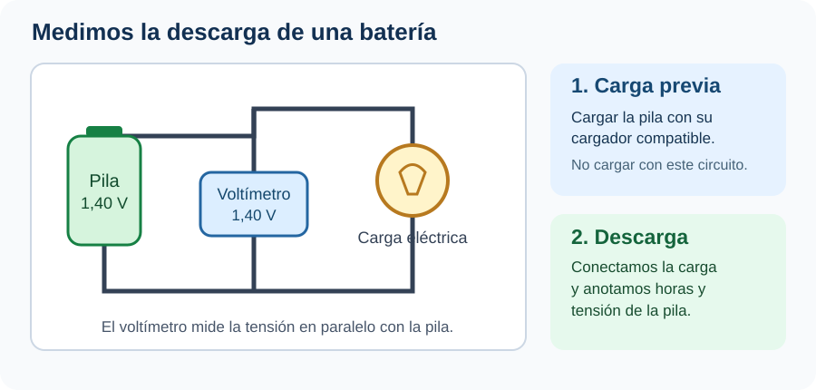
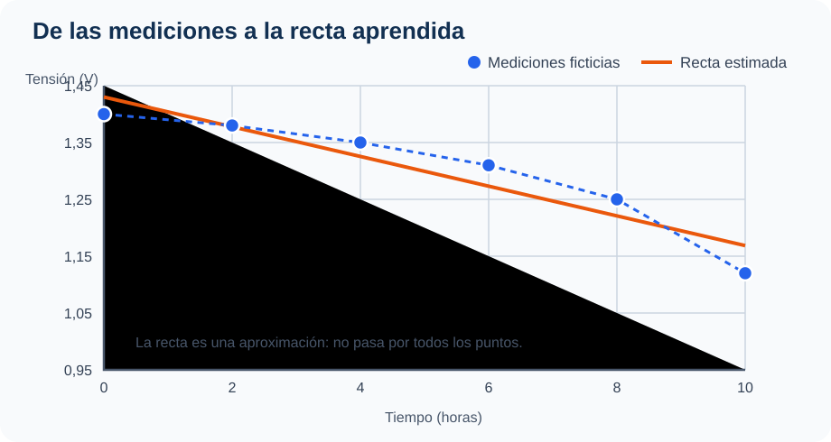

# Actividad 5. ¿Puede una neurona predecir la descarga de una batería?

**Materia:** Digitalización · 4.º ESO · Tema 8: Programación e inteligencia artificial  
**Duración orientativa:** 2 sesiones de 55 minutos · **Modalidad:** individual o parejas  
**Materiales:** ordenador con conexión a Internet, [Google Colab](https://colab.research.google.com/), Python, NumPy, TensorFlow y Matplotlib.  
**Tipo de aprendizaje:** regresión supervisada con una única neurona lineal.

[Volver al tema 8](../tema-08.md) · [Volver al índice de actividades](README.md)

## Cuaderno interactivo en Google Colab

**[Abrir el código completo en Google Colab](https://colab.research.google.com/github/bitschips/digitaliza4/blob/main/temas/tema-08-programacion-e-inteligencia-artificial/actividades/actividad-05-descarga-bateria-tensorflow.ipynb)**. El cuaderno contiene los **siete bloques de Python** de esta actividad, separados por pasos y preparados para ejecutar en orden, sin copiar ni pegar. Pulsa el botón ▶ de cada celda. Para conservar tus cambios, utiliza **Archivo → Guardar una copia en Drive**. Si Colab pregunta si confías en el cuaderno, revisa el código antes de ejecutarlo.

[Ver o descargar el archivo .ipynb](actividad-05-descarga-bateria-tensorflow.ipynb).

## Objetivos

- Comprender que el **tiempo es una entrada (X)** y la **tensión es la salida deseada (Y)**.
- Distinguir **número de entradas** de **número de ejemplos de entrenamiento**.
- Construir una neurona `Dense(1)`, identificar su peso y su sesgo y entrenarla.
- Comparar los puntos medidos con la recta de predicción y estimar una tensión no medida.
- Observar cómo varía el error con 100, 500 y 1.000 épocas, sin afirmar que más épocas siempre garantizan mejores resultados.
- Reconocer los límites de una recta para representar una descarga real no lineal.

## 1. Situación: medimos una pila que se descarga

Imagina una pila recargable que alimenta una pequeña lámpara o una carga adecuada. Medimos su tensión con un voltímetro mientras pasa el tiempo. Primero se **carga la pila con su cargador compatible**; después, en un proceso diferente, se conecta una carga y se registra su **descarga**.



**Interpretación del esquema:** la pila alimenta una carga eléctrica; el voltímetro está conectado en paralelo para medir la tensión. La fase de carga previa requiere un cargador adecuado y **no se realiza con el circuito mostrado**. El esquema es didáctico, no una guía de montaje universal.

> **Seguridad:** no cortocircuites pilas ni baterías, ni improvises cargadores, ni dejes una descarga sin supervisión. No todas las químicas admiten la misma tensión, corriente o límite de descarga. Para esta actividad basta con los datos simulados: **no hace falta montar el circuito**.

Nos planteamos esta pregunta: **si sabemos cuánto tiempo lleva descargándose la pila, ¿podemos estimar su tensión?**

## 2. Nuestra tabla de entrenamiento

Estos son **datos ficticios**, elegidos únicamente para aprender a programar:

| Tiempo transcurrido, X | Tensión, Y |
|---:|---:|
| 0 horas | 1,40 V |
| 2 horas | 1,38 V |
| 4 horas | 1,35 V |
| 6 horas | 1,31 V |
| 8 horas | 1,25 V |
| 10 horas | 1,12 V |

**Importante:** tenemos **una única entrada**, el tiempo, y **una salida**, la tensión. Las seis filas son **seis ejemplos**, no seis entradas. Más adelante se pueden añadir mediciones reales a las 20, 40, 60 o 100 horas; el modelo seguirá teniendo una entrada.

### Código 1. Introducir los datos

Abre Google Colab, crea un cuaderno y ejecuta esta celda:

```python
import numpy as np

X = np.array([0, 2, 4, 6, 8, 10], dtype=np.float32)
Y = np.array([1.40, 1.38, 1.35, 1.31, 1.25, 1.12], dtype=np.float32)

print("Tiempos (horas):", X)
print("Tensiones (voltios):", Y)
```

**Explicación línea por línea:**

1. `import numpy as np`: importa **NumPy**, la biblioteca para trabajar con datos numéricos; `np` es su nombre abreviado.
2. `X = np.array(...)`: crea un array con los tiempos. El modelo recibirá **un valor de X por ejemplo**.
3. `Y = np.array(...)`: crea otro array con las tensiones correctas que queremos que el modelo aprenda a aproximar.
4. `dtype=np.float32`: pide números decimales de 32 bits, apropiados para TensorFlow.
5. `print(...)`: muestra ambos arrays para comprobar que están bien escritos; **todavía no entrena nada**.

**Pregunta 1.** ¿Cuántos ejemplos hay? ¿Cuántas entradas recibe cada ejemplo? ¿Qué tensión corresponde a X = 6?

## 3. Antes de entrenar: una recta y una neurona

La neurona lineal calcula:

```text
Tensión estimada = (peso × tiempo) + sesgo
V(t) = w · t + b
```

- **Peso (w):** determina la pendiente de la recta, es decir, cómo cambia la tensión al aumentar el tiempo.
- **Sesgo (b):** determina la tensión que la recta predice en la hora cero.
- **Predicción:** es el resultado del modelo; puede diferir de la tensión medida.



**Cómo leer el dibujo:** los puntos azules son los datos ficticios; la línea discontinua azul los une para facilitar la lectura, pero no es la predicción. La línea naranja es un **ajuste lineal de referencia**; su posición es aproximada y todavía **no procede de ejecutar nuestro código de TensorFlow**. Cuando ejecutemos el programa, dibujaremos nuestra propia recta entrenada.

### Código 2. Crear la neurona

```python
import tensorflow as tf

tf.keras.utils.set_random_seed(42)

modelo = tf.keras.Sequential([
    tf.keras.Input(shape=(1,)),
    tf.keras.layers.Dense(1)
])

modelo.summary()
```

**Explicación línea por línea:**

1. `import tensorflow as tf`: importa TensorFlow; `tf` es el alias abreviado.
2. `set_random_seed(42)`: fija una semilla para hacer más reproducibles las inicializaciones y comparaciones (pueden persistir pequeñas variaciones entre entornos).
3. `tf.keras.Sequential([...])`: crea un modelo cuyas capas se ejecutan en secuencia.
4. `tf.keras.Input(shape=(1,))`: indica que **cada ejemplo contiene una característica**, el tiempo; la coma pertenece a la sintaxis de una tupla de Python.
5. `tf.keras.layers.Dense(1)`: crea una capa completamente conectada con **una neurona de salida**. No indicamos activación, por lo que usa una transformación lineal (más exactamente, afín).
6. `modelo.summary()`: muestra la estructura y el número de parámetros. Con una entrada y una neurona habrá **dos parámetros entrenables: un peso y un sesgo**.

**Pregunta 2.** ¿Qué significa el `1` de `Input(shape=(1,))`? ¿Y el `1` de `Dense(1)`? ¿Son lo mismo?

## 4. Entrenar la neurona: probar, medir el error y corregir

Para que los números de entrada estén en una escala pequeña, dividimos las horas entre 10. Este cambio **no modifica la información**: por ejemplo, 7 horas pasan a ser 0,7. Al hacer predicciones debemos aplicar el mismo cambio.

### Código 3. Preparar y entrenar

```python
X_normalizado = X / 10.0

modelo.compile(
    optimizer=tf.keras.optimizers.Adam(learning_rate=0.05),
    loss="mse"
)

historial = modelo.fit(
    X_normalizado,
    Y,
    epochs=1000,
    verbose=0
)

print("Error final (MSE):", historial.history["loss"][-1])
```

**Explicación línea por línea:**

1. `X_normalizado = X / 10.0`: divide los tiempos entre diez; el intervalo 0–10 horas se convierte en 0–1.
2. `modelo.compile(...)`: configura **cómo se entrenará** la neurona.
3. `optimizer=...Adam(...)`: selecciona el algoritmo que modifica el peso y el sesgo para reducir el error.
4. `learning_rate=0.05`: indica el tamaño de los ajustes del optimizador. Demasiado grande puede dificultar el aprendizaje; demasiado pequeño puede hacerlo lento.
5. `loss="mse"`: emplea el **error cuadrático medio**: eleva al cuadrado las diferencias entre predicciones y tensiones correctas y calcula su promedio. Sus unidades aquí son V².
6. `modelo.fit(X_normalizado, Y, ...)`: entrena utilizando parejas de **tiempo y tensión**.
7. `epochs=1000`: realiza mil pasadas por el conjunto de entrenamiento.
8. `verbose=0`: evita imprimir el progreso de cada época.
9. `historial.history["loss"][-1]`: recupera el último error almacenado. `[-1]` selecciona el último elemento de la lista.

**Pregunta 3.** ¿Qué hace el optimizador? ¿Para qué sirve el error MSE? ¿Qué significa una época?

## 5. Dibujar lo aprendido

### Código 4. Comparar medidas y predicciones

```python
import matplotlib.pyplot as plt

horas = np.linspace(0, 10, 101)
horas_normalizadas = (horas / 10.0).astype(np.float32)
predicciones = modelo.predict(horas_normalizadas, verbose=0).flatten()

plt.scatter(X, Y, label="Datos de entrenamiento")
plt.plot(horas, predicciones, label="Recta aprendida")
plt.xlabel("Tiempo (horas)")
plt.ylabel("Tensión (voltios)")
plt.title("Predicción de descarga de una batería")
plt.grid(True)
plt.legend()
plt.show()
```

**Explicación línea por línea:**

1. `import matplotlib.pyplot as plt`: importa herramientas para dibujar gráficas.
2. `np.linspace(0, 10, 101)`: genera 101 tiempos repartidos uniformemente entre 0 y 10 horas.
3. `horas / 10.0`: aplica **la misma normalización** que en el entrenamiento.
4. `.astype(np.float32)`: mantiene el tipo numérico utilizado en los datos de entrenamiento.
5. `modelo.predict(...)`: solicita las predicciones de tensión para esos tiempos.
6. `.flatten()`: transforma el resultado en un array de una dimensión, más cómodo para dibujarlo.
7. `plt.scatter(X, Y, ...)`: dibuja los seis puntos de medición.
8. `plt.plot(horas, predicciones, ...)`: dibuja la **recta que ha aprendido TensorFlow**.
9. `xlabel`, `ylabel` y `title`: añaden nombres a los ejes y al gráfico.
10. `grid` y `legend`: muestran una cuadrícula y explican qué representa cada serie.
11. `show()`: presenta la figura.

**Pregunta 4.** ¿La recta pasa por todos los puntos? ¿Dónde se separa más de las mediciones? ¿Por qué una única neurona lineal no puede reproducir exactamente una descarga curva?

## 6. Pedir una predicción

No habíamos medido la pila a las **7 horas**. Pedimos al modelo que la estime.

### Código 5. Interpolar

```python
tiempo_nuevo = np.array([7.0], dtype=np.float32)
tension_estimada = modelo.predict(tiempo_nuevo / 10.0, verbose=0)

print(f"Tensión estimada a las 7 horas: {tension_estimada[0, 0]:.3f} V")
```

**Explicación línea por línea:**

1. `np.array([7.0], dtype=np.float32)`: prepara el nuevo tiempo en un array.
2. `tiempo_nuevo / 10.0`: aplica la normalización usada al entrenar.
3. `modelo.predict(...)`: devuelve la predicción; con una neurona de salida y un ejemplo, tiene forma (1, 1).
4. `tension_estimada[0, 0]`: toma la primera (y única) predicción.
5. `:.3f`: muestra tres cifras decimales.

**Pregunta 5.** ¿Estamos interpolando o extrapolando? Explica por qué predecir a las 7 horas es diferente de intentar predecir a las 80 horas con datos que solo llegan hasta las 10 horas.

## 7. Descubrir el peso y el sesgo

### Código 6. Leer la ecuación aprendida

```python
pesos, sesgos = modelo.layers[0].get_weights()

w = float(pesos[0, 0]) / 10.0
b = float(sesgos[0])

print(f"V(t) = {w:.5f} · t + {b:.5f}")
```

**Explicación línea por línea:**

1. `modelo.layers[0]`: selecciona la primera capa del modelo, nuestra capa `Dense`. La capa `Input` no aparece como capa entrenable en esta lista.
2. `.get_weights()`: recupera sus parámetros aprendidos.
3. `pesos`: contiene el peso de la conexión entre la entrada y la neurona.
4. `sesgos`: contiene el sesgo de la neurona.
5. `pesos[0, 0] / 10.0`: convierte la pendiente desde el **tiempo normalizado** a las **horas originales**.
6. `float(...)`: convierte el valor numérico para mostrarlo con facilidad.
7. `print(f"...")`: imprime la ecuación; `:.5f` redondea la presentación a cinco decimales.

**Pregunta 6.** ¿Esperas que `w` sea positivo o negativo? ¿Qué representa `b` físicamente en nuestro ejemplo?

## 8. Investigación: ¿qué ocurre con 100, 500 y 1.000 épocas?

Para comparar con justicia, crearemos **un modelo nuevo desde la misma semilla** para cada cantidad de épocas. Así no acumulamos accidentalmente 100 + 500 + 1.000 épocas sobre el mismo modelo.

### Código 7. Comparar entrenamientos

```python
resultados = []

for n_epocas in [100, 500, 1000]:
    tf.keras.utils.set_random_seed(42)

    prueba = tf.keras.Sequential([
        tf.keras.Input(shape=(1,)),
        tf.keras.layers.Dense(1)
    ])

    prueba.compile(
        optimizer=tf.keras.optimizers.Adam(learning_rate=0.05),
        loss="mse"
    )

    historia = prueba.fit(X_normalizado, Y, epochs=n_epocas, verbose=0)
    error = historia.history["loss"][-1]
    pred_7h = prueba.predict(
        np.array([0.7], dtype=np.float32), verbose=0
    )[0, 0]

    resultados.append((n_epocas, error, pred_7h))

for epocas, error, tension in resultados:
    print(f"{epocas} épocas: MSE={error:.6f}, V(7h)={tension:.3f} V")
```

**Explicación línea por línea:**

1. `resultados = []`: crea una lista vacía donde guardaremos el resultado de cada experimento.
2. `for n_epocas in [100, 500, 1000]:`: repite el experimento tres veces.
3. `set_random_seed(42)`: restablece la semilla antes de crear cada modelo, para favorecer una comparación reproducible.
4. `prueba = ...Dense(1)`: construye **una neurona nueva** en cada repetición.
5. `prueba.compile(...)`: configura el mismo optimizador y la misma función de error.
6. `prueba.fit(..., epochs=n_epocas)`: entrena exactamente el número de épocas que corresponda a esa repetición.
7. `historia.history["loss"][-1]`: obtiene el error final de esa prueba.
8. `np.array([0.7])`: introduce **7 horas normalizadas**, equivalentes a 7/10.
9. `prueba.predict(...)[0, 0]`: recupera la tensión estimada a las 7 horas.
10. `resultados.append(...)`: guarda épocas, error y predicción.
11. El segundo `for` y `print` muestran una fila de resultados por experimento.

Completa esta tabla con los números que obtengas:

| Épocas | Error final (MSE) | Predicción a 7 horas |
|---:|---:|---:|
| 100 | | |
| 500 | | |
| 1.000 | | |

**Pregunta 7.** ¿En qué entrenamiento obtuviste menor error? ¿La mejora entre 500 y 1.000 épocas fue tan grande como entre 100 y 500? **Ojo:** más entrenamiento no garantiza una predicción perfecta, especialmente si el modelo solo puede dibujar una recta.

## 9. Reto de ampliación: la batería puede durar 60–100 horas

En una batería real, podríamos medir cada 5 o 10 horas durante buena parte de la descarga y **con mayor frecuencia cuando la tensión comienza a caer rápidamente**. No debemos inventar tensiones: hay que sustituir los arrays X e Y por mediciones recogidas con el mismo montaje y en condiciones controladas.

**Pregunta 8.** Si recogemos 30 parejas (tiempo, tensión), ¿cuántas entradas tendrá la neurona? ¿Cuántos ejemplos tendrá el entrenamiento? ¿Por qué no sería fiable pedirle una predicción a las 100 horas si solo la entrenamos con datos de 0 a 10 horas?

**Para después:** una batería real no tiene por qué descargarse siguiendo una recta. En una actividad futura probaremos varias neuronas y activaciones no lineales para aproximar una **curva**. No es necesario hacerlo hoy.

## Entrega

Entrega un cuaderno de Google Colab o un enlace accesible al profesor que contenga: las siete celdas de código ejecutadas, la gráfica de datos y predicciones, la ecuación aprendida, la tabla de comparación de épocas y las respuestas razonadas a las ocho preguntas. Añade una breve conclusión: **«¿Qué ha aprendido realmente nuestra neurona?»**

## Evaluación (10 puntos)

| Criterio | Puntos |
|---|---:|
| Identifica correctamente X, Y y los ejemplos | 2 |
| Comprende la neurona, el peso y el sesgo | 2 |
| Ejecuta y explica el entrenamiento y el error | 2 |
| Interpreta la gráfica y la predicción | 2 |
| Compara épocas, razona límites y presenta el trabajo | 2 |
| **Total** | **10** |

### Orientaciones para el profesorado

- En el paso 2, el alumno debe distinguir **una entrada** de **seis ejemplos**.
- Los seis puntos ficticios producen, mediante ajuste lineal por mínimos cuadrados, una recta de referencia próxima a **V(t) = −0,02614·t + 1,43238** y **V(7) ≈ 1,249 V**. TensorFlow se aproxima a esta solución, pero el resultado concreto puede variar por el entrenamiento.
- **MSE** no representa una probabilidad ni un porcentaje de aciertos; en esta regresión tiene unidades de voltios al cuadrado.
- No introducir una activación no lineal ni más capas en esta primera práctica; dejar esa comparación para la actividad siguiente.
- Normalizar dividiendo entre 10 es apropiado para el **ejemplo didáctico de 0–10 horas**. Si los datos reales llegan hasta 100 horas, revisar el factor de normalización y usarlo de forma coherente en entrenamiento, predicciones y recuperación de la ecuación.
- Esta actividad ilustra el **ajuste a datos de entrenamiento**, no verifica por sí sola la capacidad de generalizar a nuevas baterías o condiciones. Una evaluación más rigurosa requeriría mediciones independientes.
- No hace falta montar un circuito eléctrico; los datos ficticios son suficientes.

---

## Control de versiones

- **Versión:** 1.0.0
- **Fecha:** 23/11/2026
- **Estado:** Actividad publicada · ampliable
