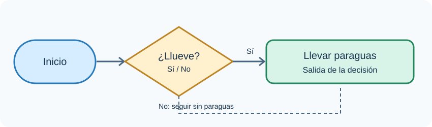
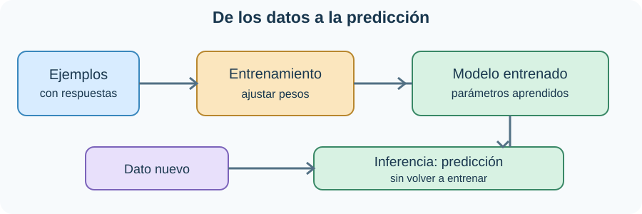
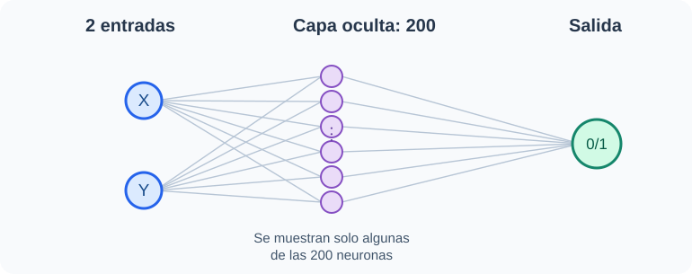
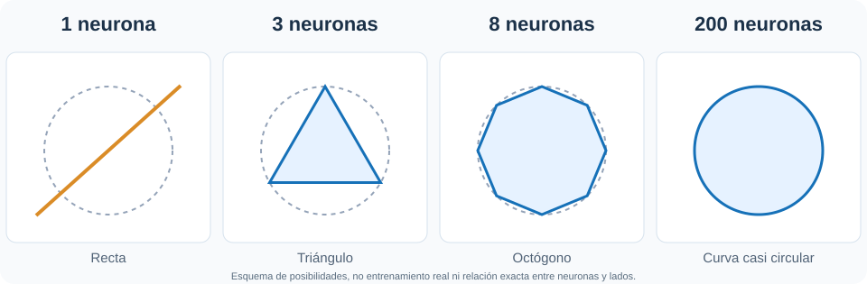
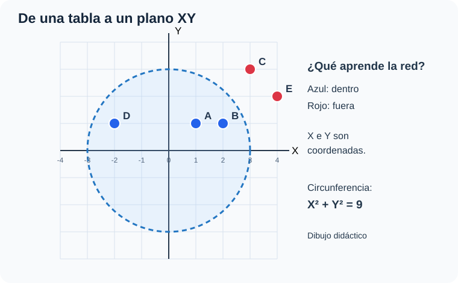
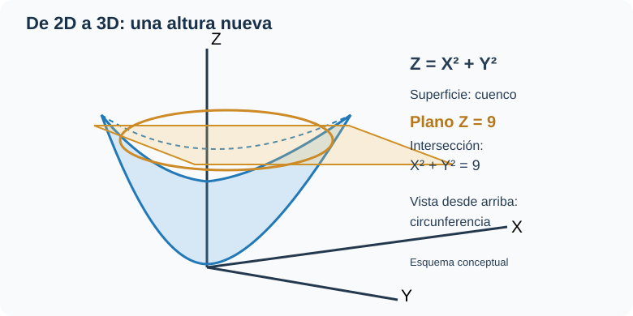
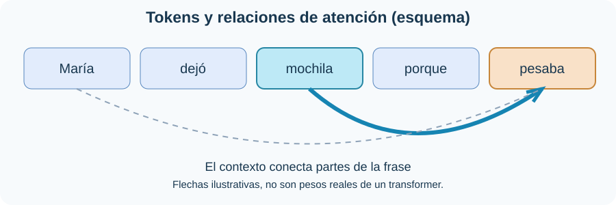

# Tema 8. Programación e inteligencia artificial

**Materia:** Digitalización · 4.º ESO · Comunitat Valenciana  
**Estado:** Índice y guía inicial · contenido ampliable  
**Fecha:** 23/11/2026

[Volver al índice general](../../README.md)

## Materiales del tema

- [Presentación HTML — abrir en el navegador](https://htmlpreview.github.io/?https://github.com/bitschips/digitaliza4/blob/main/temas/tema-08-programacion-e-inteligencia-artificial/presentaciones/tema-08.html)
- [Presentación PPTX — descargar](presentaciones/tema-08-programacion-e-inteligencia-artificial.pptx)

> Los materiales de NotebookLM se añadirán manualmente cuando estén disponibles.

## Objetivos de aprendizaje

Al finalizar este tema, el alumnado debería poder:
- Reconocer qué es un algoritmo y representar una secuencia de instrucciones.
- Comprender conceptos básicos de programación y resolver pequeños problemas.
- Diferenciar programación tradicional, aprendizaje automático e IA generativa.
- Explicar de forma introductoria cómo se entrenan algunos modelos de IA y por qué pueden cometer errores.
- Experimentar con ejemplos sencillos de relaciones entre palabras y mecanismos de atención.

## Índice de contenidos

1. ¿Qué es programar? Algoritmos y pensamiento computacional.
2. Conceptos básicos de programación: instrucciones, variables y condiciones.
3. Repeticiones, funciones y depuración de errores.
4. ¿Qué es la inteligencia artificial? Ejemplos cotidianos.
5. De los datos al aprendizaje automático: entrenamiento e inferencia.
6. Redes neuronales e inteligencia artificial generativa.
7. ¿Cómo trabajan los modelos de lenguaje? Tokens, patrones y atención.
8. Aplicaciones, límites y uso responsable de la IA.
9. Actividades propuestas.
10. Preguntas de repaso.
11. Glosario básico.

> **Nota editorial:** este documento establece el índice del tema, como punto de partida para desarrollar posteriormente los apartados con explicaciones, ejemplos y recursos. Los títulos son una propuesta didáctica y no una transcripción literal de epígrafes oficiales.

## 1. ¿Qué es programar? Algoritmos y pensamiento computacional?

**Idea principal:** un algoritmo es una secuencia finita de pasos para resolver un problema. Programar consiste en expresar instrucciones en un lenguaje que pueda ejecutar un sistema.

**Ejemplo:** describir paso a paso cómo decidir si es necesario llevar paraguas según la previsión meteorológica.

**Cómo interpretar el dibujo:** las flechas muestran el orden, el rombo representa una pregunta y los bloques muestran el comienzo o una acción. Un algoritmo tiene decisiones y posibles caminos; el diagrama es una simplificación visual.

## 2. Conceptos básicos de programación: instrucciones, variables y condiciones

Una **variable** permite almacenar un dato y una **condición** selecciona qué instrucciones ejecutar según el resultado de una comprobación.

**Ejemplo:** si la temperatura baja de 10 °C, mostrar el mensaje «Hace frío».

## 3. Repeticiones, funciones y depuración de errores

Los **bucles** repiten instrucciones, las **funciones** agrupan operaciones reutilizables y la **depuración** ayuda a localizar y corregir errores.

## 4. ¿Qué es la inteligencia artificial? Ejemplos cotidianos

La IA agrupa técnicas que permiten a sistemas informáticos realizar tareas como reconocer patrones, clasificar imágenes o generar texto.

**Ejemplos:** filtros de correo no deseado, reconocimiento de voz y asistentes de texto.

## 5. De los datos al aprendizaje automático: entrenamiento e inferencia

En el **entrenamiento**, un modelo ajusta parámetros utilizando datos y un objetivo de aprendizaje. En la **inferencia**, utiliza lo aprendido para procesar entradas nuevas.

**Lectura del esquema:** durante el entrenamiento se utilizan ejemplos para ajustar los pesos. Después, el modelo entrenado recibe datos nuevos y calcula una predicción. Esta segunda fase se llama *inferencia*.

## 6. Redes neuronales e inteligencia artificial generativa

Una **red neuronal artificial** combina numerosas operaciones matemáticas parametrizadas. Los modelos generativos producen contenido nuevo, como texto o imágenes, a partir de patrones aprendidos.

**Cómo leer la red:** X e Y son los dos datos originales de entrada; cada neurona oculta combina números mediante pesos y una función de activación. La salida clasifica el punto. Las seis neuronas visibles solo simbolizan una capa de **200 neuronas**: no se dibujan las 200 individualmente.

**Una recta, muchas posibilidades:** con una neurona y dos entradas X/Y, una frontera lineal es recta. Al combinar neuronas ocultas con activaciones no lineales podemos obtener fronteras poligonales que se aproximan a un círculo. **200 neuronas no equivalen necesariamente a 200 líneas**; la imagen es una comparación conceptual, no una simulación de entrenamiento.

**De los datos al dibujo:** una fila con X = 2 e Y = 1 sitúa un punto en el plano; el color puede indicar su clase. Así se ve qué está intentando separar la red.

**Relación 2D–3D:** en dos dimensiones, una frontera lineal es una **recta**; en tres, es un **plano**. Si definimos la altura **Z = X² + Y²**, obtenemos una superficie curva (*paraboloide*). El plano **Z = 9** corta esa superficie formando una circunferencia vista desde arriba. Calcular X² e Y² no crea automáticamente una tercera dimensión: aquí hemos definido Z para visualizarla. [Practicar este ejemplo en la actividad 4](actividades/actividad-04-neuronas-fronteras-2d-3d.md).

## 7. ¿Cómo trabajan los modelos de lenguaje? Tokens, patrones y atención

Los modelos de lenguaje convierten fragmentos de texto (**tokens**) en representaciones numéricas. Una de las técnicas utilizadas en los modelos tipo *transformer* es el **mecanismo de atención**, que permite combinar información de distintas posiciones de una secuencia.

**Ejemplo de aula:** «María dejó la mochila en el suelo porque pesaba mucho». El contexto ayuda a interpretar que probablemente pesaba la mochila. Esta explicación es una **simplificación didáctica**: el mecanismo matemático real calcula relaciones entre representaciones, no simplemente flechas entre palabras.

En ciertos mecanismos de atención aparecen tres elementos: **Q (Query)**, **K (Key)** y **V (Value)**. Se emplean para calcular la relevancia relativa de la información y combinarla.

**Cómo interpretar la figura:** los bloques representan fragmentos de texto y las flechas ejemplifican cómo el contexto ayuda a relacionarlos. En un modelo real, los tokens no siempre coinciden con palabras completas y la atención se calcula con números, no con flechas literales.

## 8. Aplicaciones, límites y uso responsable de la IA

Las respuestas de una IA pueden ser útiles, pero también incorrectas o ambiguas. Conviene contrastar la información, proteger los datos personales y reconocer cuándo se ha usado una herramienta de IA.

## 9. Actividades propuestas

**[Abrir el índice de actividades del tema](actividades/README.md)**. Cada actividad tiene su **enunciado completo** en un archivo independiente de la carpeta `actividades/`:

1. **[¿Cómo relaciona las palabras una inteligencia artificial?](actividades/actividad-01-mecanismo-de-atencion.md)**: visualizar el vídeo de apoyo, resolver frases ambiguas y dibujar relaciones de atención entre palabras.
2. **[Diseña un algoritmo cotidiano](actividades/actividad-02-algoritmos-cotidianos.md)**: redactar instrucciones precisas, elaborar un diagrama de flujo y realizar pruebas.
3. **[Tu primer programa: condiciones y bucles](actividades/actividad-03-programacion-basica.md)**: ejecutar, comprender y modificar un programa en Python.
4. **[¿Cuántas neuronas hacen falta para dibujar un círculo?](actividades/actividad-04-neuronas-fronteras-2d-3d.md)**: experimentar con entradas X/Y, fronteras de decisión y una representación 3D, mediante tablas y gráficos.
5. **[¿Puede una neurona predecir la descarga de una batería?](actividades/actividad-05-prediccion-descarga-bateria-tensorflow.md)**: introducir datos de tiempo y tensión, entrenar una neurona lineal con TensorFlow, dibujar la recta y comparar épocas y predicciones.

## 10. Preguntas de repaso

- ¿Qué diferencia hay entre algoritmo y programa?
- ¿Para qué sirve una variable?
- ¿Cuándo utilizamos una condición y cuándo un bucle?
- ¿En qué se diferencian entrenamiento e inferencia?
- ¿Qué es un token?
- ¿Para qué sirve el mecanismo de atención en un modelo de lenguaje?
- ¿Por qué una frase ambigua puede tener más de una interpretación?

## 11. Glosario básico

- **Algoritmo:** conjunto ordenado de pasos para resolver un problema.
- **Variable:** nombre asociado a un dato que puede utilizar un programa.
- **Bucle:** estructura para repetir instrucciones.
- **Entrenamiento:** proceso de ajuste de los parámetros de un modelo mediante datos.
- **Inferencia:** uso del modelo entrenado sobre una nueva entrada.
- **Token:** unidad de texto procesada por un modelo; no coincide necesariamente con una palabra completa.
- **Atención:** mecanismo matemático que combina información de distintas partes de una secuencia.
- **Modelo generativo:** sistema capaz de producir nuevos contenidos a partir de patrones aprendidos.

---

## Control de versiones

- **Versión del contenido:** 1.3.0
- **Última actualización:** 23/11/2026
- **Estado:** Índice y guía inicial · ampliable
